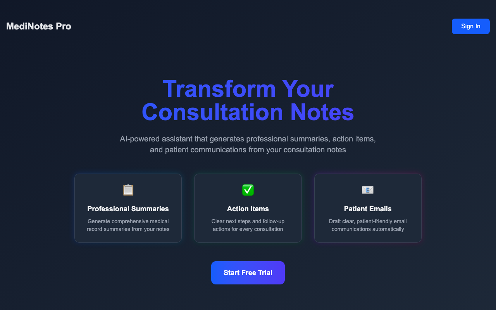

# MediNotes Pro — Healthcare Consultation Assistant

An AI-powered web app that turns a doctor's consultation notes into a structured visit summary,
next steps for the doctor, and a patient-friendly email draft, streamed live as the model writes.

**Live demo:** https://saas-liard-five.vercel.app (sign in to try the generator)



## What it does

- Collects patient name, visit date, specialty, and free-text consultation notes.
- Generates three sections with OpenAI: a summary for the doctor's records, next steps, and an email
  to the patient in plain language. Prompts adapt to the selected specialty.
- Streams the response token by token with Server-Sent Events, so long outputs appear immediately.
- Protects the generator behind Clerk authentication; the backend verifies each request's JWT.

## Architecture

```text
Next.js (React, TypeScript, Tailwind) ── Clerk sign-in
        │  POST visit details + Clerk JWT
        ▼
FastAPI ── verifies JWT (fastapi-clerk-auth) ── OpenAI chat completion (streamed)
        │  Server-Sent Events
        ▼
Browser renders Markdown as it arrives
```

Two deployment targets share the same API logic:

| Target | Entry point | Notes |
| --- | --- | --- |
| Vercel (live demo) | `api/index.py` | Next.js frontend plus a Python serverless function |
| AWS App Runner | `api/server.py` + `Dockerfile` | Multi-stage image: static Next.js export served by FastAPI, `/health` check |

## Run locally

Prerequisites: Node.js 18+, Python 3.12, a Clerk application, and an OpenAI API key.

```bash
npm install
pip install -r requirements.txt
```

Create `.env.local` with:

```text
NEXT_PUBLIC_CLERK_PUBLISHABLE_KEY=...
CLERK_SECRET_KEY=...
CLERK_JWKS_URL=...
OPENAI_API_KEY=...
```

Then start the app with `npm run dev`.

## Tech stack

Next.js · React · TypeScript · Tailwind CSS · FastAPI · Python · OpenAI API · Server-Sent Events ·
Clerk · Docker · AWS App Runner · Vercel

## Disclaimer

A learning project, not a medical device. Generated text must be reviewed by a clinician, and real
patient data should not be entered into the demo.
